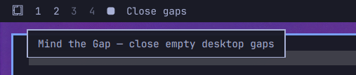

# Mind the Gap

**Close the gaps in your Omarchy desktops—when you choose.**

A small Omarchy bar plugin that reveals a **Close gaps** button beside your
workspace numbers when you hover the bar, and only when there are gaps to close.



## Why?

You have windows on desktops **1, 2, 5 and 6**. Desktops 3 and 4 are empty,
but the remaining windows stay on their old numbers.

Click **Close gaps** and the occupied desktops become **1, 2, 3 and 4**.
Their order stays the same, windows on the same desktop move together, and
your focused window follows its new desktop number.

Nothing moves automatically. You decide when to tidy up.

## Install

### Ask your AI agent

Point your AI agent in Omarchy at this repo, or copy this prompt using the copy
button in the top-right corner of the box:

```text
Install Mind the Gap on my Omarchy desktop:
https://github.com/nickdc8/omarchy-mind-the-gap

Read the README and inspect the plugin source.
Check compatibility, then install and enable it.

Back up my bar configuration. Place nickdc8.mind-the-gap
immediately after my existing Workspaces widget,
preserving my other widgets and settings.

Reload the bar if needed and check for loading errors.
Keep compaction manual: show Close gaps on bar hover
only when there are gaps.

Do not move my windows just to test it.
```

### Install manually

Requires Omarchy Quattro's Quickshell bar, a Lua-enabled Hyprland
(`hl.dsp.window.move` and `hl.dsp.focus`), and Python 3.

```bash
omarchy plugin add https://github.com/nickdc8/omarchy-mind-the-gap.git --enable
```

Place the widget immediately after **Workspaces** using Omarchy's bar settings.
Alternatively, the relevant part of `~/.config/omarchy/shell.json` is:

```json
"left": [
  { "id": "omarchy.menu" },
  { "id": "omarchy.workspaces" },
  { "id": "nickdc8.mind-the-gap" }
]
```

This is a layout excerpt; keep your other bar entries and settings.

## Use

1. Hover anywhere on the bar.
2. If occupied numbered desktops have a gap, **Close gaps** appears.
3. Click it to compact the desktops. The button disappears once there are no gaps.

Gap detection refreshes when you enter the bar and once per second while hovering.
There is no background compaction service.

## Behaviour and limits

- Occupied numeric desktops are packed into the lowest available numbers, in order.
- Named, special/scratchpad and persistent workspaces are left alone. Positive IDs
  belonging to named or persistent workspaces are reserved.
- Empty desktops after the last occupied desktop are not gaps.
- **Single monitor only:** the button stays hidden with multiple active monitors.
- Windows move using Hyprland's silent window dispatcher. **Tiled layouts can
  reflow**; this does not preserve the exact layout tree.
- Pinned windows are skipped. Unusual pinned/grouped/fullscreen setups have not
  been comprehensively tested.
- The stock workspace widget may still display its minimum set of empty numbers.
  Mind the Gap moves windows; it does not replace the workspace indicator.
- Disabling the plugin stops future operations; it does not undo previous moves.

Tested on the author's Omarchy setup with a single monitor, including moving
occupied desktops 5 → 3, 6 → 4 and 7 → 5 while retaining all six windows.
The included automated checks cover numbering plans, not full compositor behaviour.

## Remove

```bash
omarchy plugin disable nickdc8.mind-the-gap
omarchy plugin remove nickdc8.mind-the-gap
```

## Development

`MindTheGap.qml` provides the hover button. `mind_the_gap.py --status` reports
whether a cascade is possible; `mind_the_gap.py --once` performs it.
The Python helper is resolved relative to the plugin, so installation paths and
usernames are not hardcoded.

```bash
python3 -m unittest discover -s tests
```

## Related project

[Plonk](https://github.com/nixfred/plonk) is a more comprehensive workspace
compaction tool, with automatic watching, multi-monitor support and additional
configuration. Mind the Gap is an independent, deliberately small implementation
focused on an on-demand hover button. It does not use or bundle Plonk.

## License

MIT.
